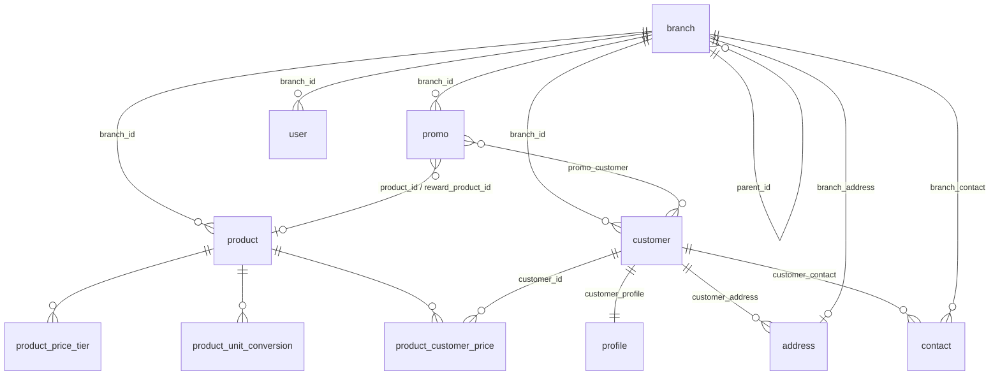
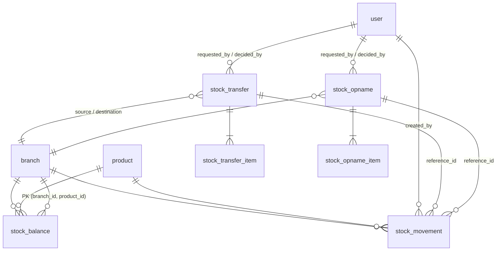
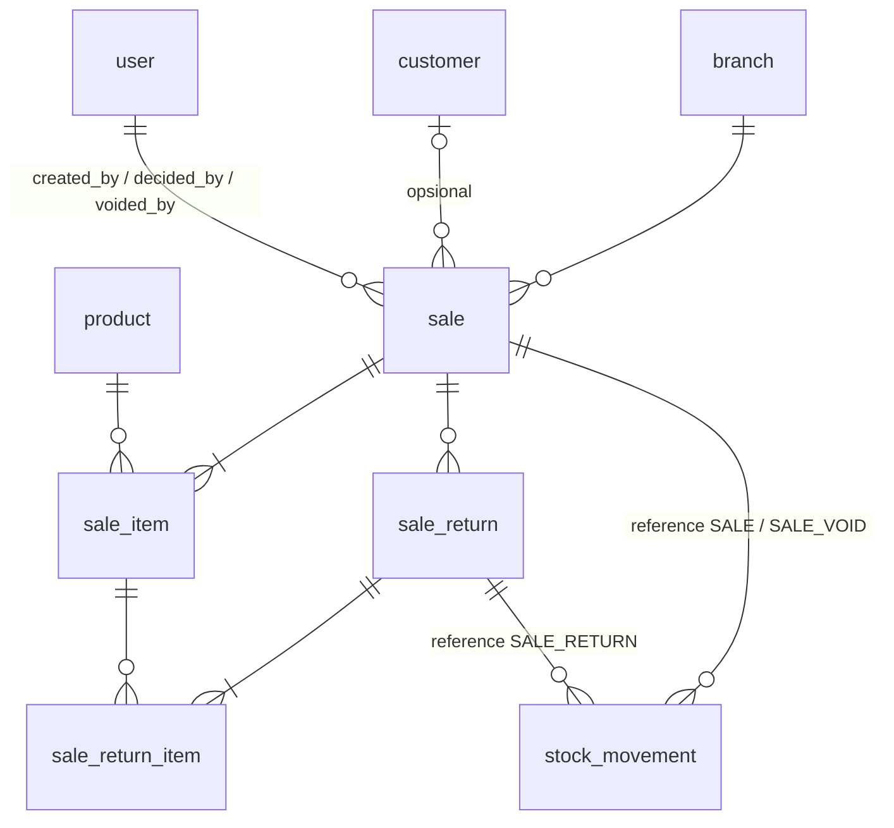
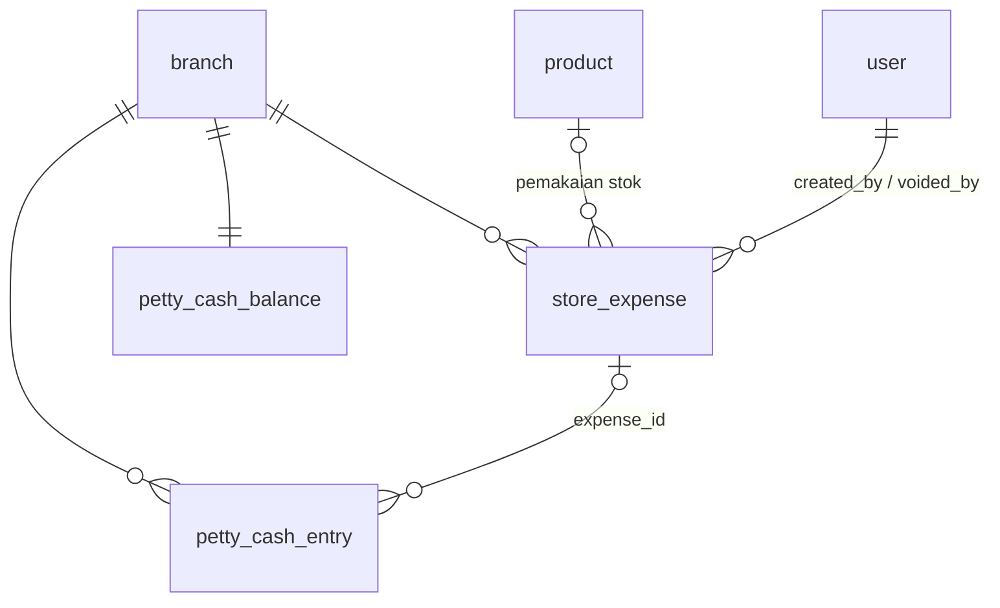

# Dokumentasi Database Saasno

Backend memakai tiga penyimpanan:

| Penyimpanan | Dipakai untuk | Catatan |
|---|---|---|
| **PostgreSQL** (`saasno`) | Seluruh data bisnis dan akses (user, role, menu, cabang, produk, customer, promo, stok) | Hibernate `ddl-auto=validate`: skema **tidak** dibuat aplikasi, diubah dengan SQL manual (lihat [Mengubah skema](#mengubah-skema)) |
| **MongoDB** (`saasno`) | Audit log semua panggilan API | Koleksi `log` |
| **Redis** | Session login | Key `session:<username>:<uuid>` |

Stok dan ledger-nya **sengaja di PostgreSQL**, bukan Mongo: saldo dan mutasi harus berubah atomik dalam satu transaksi,
dan itu hanya terjamin oleh transaksi relasional.

## Daftar isi
1. [Model akses per cabang](#model-akses-per-cabang)
2. [PostgreSQL: akses dan sistem](#postgresql-akses-dan-sistem)
3. [PostgreSQL: master data](#postgresql-master-data)
4. [PostgreSQL: stok](#postgresql-stok)
5. [PostgreSQL: transaksi penjualan](#postgresql-transaksi-penjualan)
6. [PostgreSQL: keuangan toko](#postgresql-keuangan-toko)
7. [MongoDB](#mongodb)
8. [Redis](#redis)
9. [Mengubah skema](#mengubah-skema)

---

## Model akses per cabang

`branch.parent_id` membentuk pohon cabang. Setiap user bisa ditempatkan di satu cabang (`user.branch_id`).

- **Cakupan user** = cabang sendiri + seluruh turunannya. Dihitung dari DB di setiap request (CTE rekursif), bukan dari session.
- **`user.branch_id` kosong = akses global** (super user): tidak dibatasi.
- Data di luar cakupan dijawab seperti **tidak ada** (404), bukan "dilarang", supaya keberadaannya tidak bocor.

| Data | Siapa yang melihat | Siapa yang mengubah |
|---|---|---|
| `branch`, `user`, `customer`, `promo` | Cabang pemilik dan induk-induknya | Cabang pemilik dan induk-induknya |
| `product` | Cabang pemilik, turunannya, **dan induk-induknya** | Hanya cabang pemilik dan induk-induknya (produk milik induk hanya-baca bagi cabang bawah) |
| `stock_balance`, `stock_movement` | Cabang yang bersangkutan dan induk-induknya | Lewat endpoint stok saja |
| `stock_transfer` | Cabang asal **atau** tujuan (dan induk-induknya) | Asal mengajukan, tujuan memutuskan |
| `stock_opname` | Cabang yang dihitung dan induk-induknya | Hanya di cabang pengaju; diputuskan orang lain yang cakupannya mencakup cabang itu |
| `store_expense`, `petty_cash_entry`, `petty_cash_balance` | Cabang pencatat dan induk-induknya (hanya baca bagi induk) | Hanya di cabang pencatat (catat biaya, isi kas kecil, batalkan) |
| `sale`, `sale_return` | Cabang transaksi dan induk-induknya (hanya baca bagi induk) | Hanya di cabang tempat transaksi dibuat (void, retur); persetujuan oleh user lain yang cakupannya mencakup cabang itu |

Aturan relasi antar data:
- Cabang pemilik (`branch_id`) data baru **tidak bisa diganti** setelah dibuat.
- `product_customer_price` dan `promo_customer` hanya boleh merujuk customer milik cabang data itu atau turunannya.
- `promo.product_id` / `reward_product_id` boleh merujuk produk yang terlihat oleh cabang promo (milik sendiri, turunan, atau induk).
- Cabang tidak bisa dihapus selama masih memiliki cabang anak, user, produk, promo, customer, stok, oper stok, transaksi, retur, transaksi ditahan, atau catatan keuangan (biaya, kas kecil).

---

## PostgreSQL: akses dan sistem

Semua tabel di schema `public`. `modificated` / `registered` = waktu ubah / buat (`timestamp`, tanpa zona).

| Tabel | Isi | Kolom penting |
|---|---|---|
| `user` | Akun login | `username`, `password` (Argon2id dari hash klien), `status`, `secure`, `two_factor_auth(_secret)`, **`branch_id` → `branch`** (boleh null = global) |
| `role` | Peran | `name` unik |
| `user_role` | user ↔ role | PK `(user_id, role_id)` |
| `menu` | Menu sidebar bertingkat | `url`, `icon`, `order_index`, `parent_id` |
| `role_menu` | role ↔ menu | PK `(role_id, menu_id)` |
| `api` | Katalog endpoint yang dilindungi | `id` (mis. `GET_API_PRODUCT`), `method`, `path` |
| `role_api` | role ↔ endpoint | PK `(role_id, api_id)`; **endpoint baru wajib didaftarkan di sini agar bisa dipakai** |
| `configuration` | Pengaturan key/value | `id` = key, `value` |
| `notification`, `notification_message`, `notification_unread` | Notifikasi per user dan penghitung belum dibaca | |
| `download_job` | Antrean ekspor (CSV/Excel) | `type`, `format`, `status`, `filter_json`, `requested_by` |
| `log` | **Tabel lama, tidak dipakai kode saat ini** (audit log pindah ke Mongo) | Boleh diabaikan |

Menu dan endpoint stok didaftarkan oleh migrasi `2026-10-08-stock.sql`: menu `STOCK` (Saldo Stok, Mutasi Stok, Oper Stok) dan sepuluh endpoint (sembilan dari migrasi pertama, satu daftar tujuan oper dari migrasi kedua).

---

## PostgreSQL: master data



| Tabel | Isi | Aturan |
|---|---|---|
| `branch` | Cabang; `parent_id` = induk | `serial` unik (format `MMyyyydd` + 3 digit urutan harian). Siklus ditolak aplikasi. |
| `branch_address`, `branch_contact` | Alamat (satu) dan kontak (telepon, email) cabang | Tabel penghubung ke `address` / `contact` |
| `address`, `contact`, `profile` | Data bersama untuk cabang dan customer | Dimiliki pemiliknya; ikut terhapus bersamanya |
| `customer` | Customer | **`branch_id` wajib**, `type` INDIVIDU/BISNIS, `status` ACTIVE/DISABLED, `pic`, `serial` unik |
| `customer_profile` / `customer_address` / `customer_contact` | Relasi customer ↔ profil (satu), alamat, kontak | `profile_id`, `address_id`, `contact_id` unik |
| `product` | Produk | **`branch_id` wajib** (pemilik), `price >= 0` (rupiah utuh), **`cost_price` (harga pokok, opsional, rupiah utuh >= 0)**, `unit` (satuan dasar), `status`, `serial` unik |
| `product_unit_conversion` | Konversi satuan | 1 `to_unit` = `value` satuan dasar; unik `(product_id, to_unit)` |
| `product_price_tier` | Harga bertingkat | `min_quantity > 0`, `price > 0`; unik `(product_id, min_quantity)`; makin banyak makin murah (dijaga aplikasi) |
| `product_customer_price` | Harga khusus | `target` = `TYPE` (isi `customer_type`) atau `CUSTOMER` (isi `customer_id`); unik per sasaran |
| `promo` | Promo (syarat + hadiah) | **`branch_id` wajib**, `scope` PRODUCT/TOTAL, `condition_type` QUANTITY/AMOUNT, `reward_type` DISCOUNT_FIXED/DISCOUNT_PERCENT/FREE_PRODUCT, `audience` ALL/TYPE/CUSTOMER, periode `valid_from`..`valid_until` |
| `promo_customer` | Promo ↔ customer tertentu | Dipakai bila `audience = CUSTOMER` |

Harga produk dihitung (endpoint `/api/product/price`): harga customer tertentu → harga tipe customer → harga dasar;
harga bertingkat dipakai bila lebih murah.

---

## PostgreSQL: stok



Semua jumlah dalam **satuan dasar produk** (`numeric(19,6)`). Input dengan satuan konversi dikonversi saat diterima.

### `stock_balance`: saldo
Satu baris per `(branch_id, product_id)`. `quantity >= 0` dijaga **constraint database**; pengurangan hanya terjadi lewat
`UPDATE ... WHERE quantity >= :jumlah`, jadi dua pengurangan bersamaan tidak pernah membuat saldo minus.

### `stock_movement`: ledger (append-only)
Setiap perubahan saldo menambah satu baris; tidak pernah diubah atau dihapus (**trigger `stock_movement_immutable` menolak
UPDATE/DELETE**, termasuk lewat SQL langsung).

| Kolom | Arti |
|---|---|
| `type` | `RECEIVE` stok masuk · `ADJUST` koreksi/opname · `TRANSFER_OUT` / `TRANSFER_IN` oper stok · `SALE` penjualan · `RETURN` retur atau void (referensi `SALE_RETURN` / `SALE_VOID` / `STOCK_USE_VOID`) · `USE` pemakaian stok sendiri oleh toko (referensi `STOCK_USE`) |
| `quantity` | Selisih bertanda (+ masuk, − keluar), tidak boleh 0 |
| `balance_after` | Saldo setelah perubahan; saldo selalu bisa dicocokkan ulang dari ledger |
| `reference_type` / `reference_id` | Sumber, mis. `STOCK_TRANSFER` + id oper stok |
| `note` | Wajib untuk stok masuk dan koreksi |
| `created_by` | User pembuat (FK ke `user`) |

Akibatnya, **user atau produk yang sudah punya riwayat stok tidak bisa dihapus** (409). Nonaktifkan user / produk sebagai gantinya.

### `stock_transfer` + `stock_transfer_item`: oper stok dengan persetujuan
Alur: cabang asal mengajukan → cabang tujuan menyetujui/menolak. Stok baru berpindah saat **disetujui**.

```
PENDING ──approve──> APPROVED   (stok asal berkurang, tujuan bertambah, dua baris ledger, satu transaksi)
   ├────reject────> REJECTED    (alasan wajib)
   └────cancel────> CANCELLED   (hanya pengaju)
```

- `source_branch_id <> destination_branch_id`; `serial` unik.
- Constraint `stock_transfer_decision_check`: `PENDING` ⇔ `decided_by`/`decided_at` kosong; keputusan selalu mencatat siapa dan kapan.
- Cabang asal **selalu cabang tempat pengaju berada** (tidak dipilih; ditolak 403 bila berbeda). Hanya user global (tanpa cabang) menyebutkan asal. Tujuan hanya **tetangga langsung**: induknya, anak langsungnya, atau saudaranya (satu induk yang sama). Oper **tidak boleh melompati tingkat**: A → B → C berarti dari A harus ke B dulu, dan dari C harus ke B dulu. Cabang tanpa induk tidak punya saudara. Aturan ini diperiksa saat pengajuan dan diperiksa ulang saat persetujuan.
- Penyetuju harus punya cabang tujuan dalam cakupannya dan **bukan pengaju**.
- Produk harus terlihat oleh **kedua** cabang (produk milik cabang A tidak bisa dioper ke saudaranya B).
- Persetujuan mengunci baris oper (`SELECT ... FOR UPDATE`) dan menerapkan perubahan saldo dalam urutan tetap (cabang, produk) untuk mencegah deadlock. Bila stok asal kurang saat disetujui: 409, status tetap `PENDING`, saldo tidak berubah.

### `stock_opname` + `stock_opname_item`: penghitungan stok fisik dengan persetujuan
Alur sama dengan oper stok (`PENDING` → `APPROVED` / `REJECTED` / `CANCELLED`, constraint `stock_opname_decision_check`), tetapi untuk **satu cabang**:
user di cabang itu menghitung stok fisik dan mengajukan hasilnya, orang lain (izin `PUT_API_STOCK_OPNAME_APPROVE`, cakupan mencakup cabang itu,
bukan pengaju) memutuskan.

- `stock_opname_item` mencatat `system_quantity` (saldo saat diajukan), `counted_quantity` (hasil hitung), keduanya dalam satuan dasar. Selisih = hitung - sistem.
  Hasil hitung boleh 0. Hanya produk yang diisi yang dihitung (maksimal 500 per pengajuan); satuan konversi didukung seperti stok masuk.
- Saat **disetujui**, yang diterapkan adalah **selisih**, bukan saldo diganti jumlah hitung: mutasi `ADJUST` (`reference_type = STOCK_OPNAME`,
  `reference_id` = id opname) hanya untuk item yang berselisih, ke saldo saat itu. Jadi penjualan yang terjadi selama penghitungan tidak terhapus
  (hitung 7, sistem 10, terjual 1 selama menghitung → saldo akhir 6). Kalau pengurangan membuat saldo minus: 409 dan opname tetap `PENDING`.
  Produk nonaktif tidak boleh bertambah.
- Cabang selalu cabang pengaju (403 bila menyebut cabang lain); hanya user global yang menyebutkannya. Produk harus terlihat oleh cabang itu.
- Opname/user/produk/cabang yang punya opname tidak bisa dihapus (ikut hitungan `countOwnedData`, `countStockActivity`, `countByProduct`).

---

## PostgreSQL: transaksi penjualan



Penjualan **tunai**. Cabang transaksi selalu cabang tempat kasir berada (user global memilih cabang). Semua perhitungan
(harga, promo, pajak, total) dilakukan **server**; angka dari browser tidak dipercaya.

### `sale`: header transaksi
Tidak pernah dihapus; hanya `status` dan data keputusan/pembatalan yang berubah.

| Kolom | Arti |
|---|---|
| `serial` | Nomor struk `<serial cabang>/<yyMMdd>/<urutan harian 4 digit>`, urutan per cabang per hari |
| `status` | `COMPLETED` selesai · `WAITING_APPROVAL` menunggu persetujuan diskon · `REJECTED` · `CANCELLED` (dibatalkan kasir sebelum disetujui) · `VOIDED` (dibatalkan setelah selesai) |
| `customer_id` | Opsional (tanpa customer = umum; hanya promo semua customer yang berlaku) |
| `subtotal`, `promo_discount`, `manual_discount`, `charge_total`, `total` | Nilai dibulatkan ke rupiah utuh sebelum biaya lain-lain |
| `promo_id`, `promo_name` | Promo yang dipakai (nama dibekukan; tanpa FK karena promo boleh dihapus kemudian) |
| `promo_scope`, `promo_product_id`, `promo_condition_type`, `promo_min_value`, `promo_reward_type`, `promo_discount_value`, `promo_value` | **Aturan promo yang dibekukan** saat transaksi (`promo_value` = nilai manfaatnya: potongan, atau harga barang gratis) supaya retur bisa menghitung ulang walau promonya diubah atau dihapus. Kosong pada transaksi lama (dihitung proporsional) |
| `manual_discount_reason` | Wajib bila ada diskon manual |
| `charges`, `charge_total` | Salinan biaya lain-lain saat transaksi (JSON `[{code,label,type,rate,inclusive,amount,base}]`, dibekukan) dan jumlahnya, termasuk yang sudah ada di harga. `total` = nilai akhir + biaya yang belum termasuk |
| `paid`, `change_amount` | Dibayar dan kembalian; constraint `paid >= total` dan `change_amount = paid - total` |
| `request_key` | Kunci anti dobel; unik per kasir (`sale_request_key_idx`): pengiriman ulang tidak membuat transaksi kedua |
| `created_by`, `decided_by/at/note`, `voided_by/at`, `void_reason` | Siapa membuat, memutuskan, dan membatalkan |

### `sale_item`: baris
Harga satuan, nama, dan serial produk **dibekukan** saat transaksi; mengubah master produk tidak mengubah transaksi lama.

- `quantity` dalam satuan dasar produk. `price_source` = `BASE` / `CUSTOMER` / `CUSTOMER_TYPE` / `PROMO` (barang gratis); `tier_min_quantity` bila harga bertingkat dipakai.
- `is_free`: barang gratis dari promo (harga 0, tetap mengurangi stok). Unik per `(sale_id, product_id, is_free)`.
- `discount`: diskon manual untuk baris ini. `line_total` = jumlah × harga − diskon.
- `net_total`: jumlah akhir baris setelah promo, diskon transaksi, dan pajak dialokasikan (baris terakhir menanggung sisa pembulatan, jadi jumlahnya sama dengan `total`). Potongan promo "per produk" hanya dibagi ke baris produk itu, bukan ke semua baris; promo "total" dan diskon manual transaksi dibagi sebanding nilai baris. Dasar nilai retur.
- `returned_quantity` / `returned_amount`: sudah diretur; dijaga constraint `<= quantity` / `<= net_total`.

### Aturan perhitungan (dilakukan `SaleCalculator`)
1. Harga satuan: harga customer tertentu → harga tipe customer → harga dasar; harga bertingkat dipakai bila lebih murah.
2. **Hanya satu promo yang dipakai: yang paling menguntungkan** (potongan terbesar; barang gratis dinilai dengan harganya). Promo yang dipertimbangkan: aktif, dalam periode, milik cabang transaksi **atau induk-induknya** (promo pusat berlaku di cabang di bawahnya), sasaran cocok (semua / tipe / customer tertentu), dan syarat jumlah atau nilai (per produk atau total) terpenuhi. Barang gratis hanya bila stok cukup.
3. Diskon manual (nominal; per baris dan/atau per transaksi) **bisa digabung dengan promo**; total tidak boleh negatif.
4. Pajak dari pengaturan, lalu total dibulatkan ke rupiah utuh.
5. Stok semua baris (termasuk gratis) harus cukup; bila kurang, seluruh transaksi ditolak (409).

### Diskon manual dan persetujuan
- Diskon manual hanya lewat endpoint tersendiri `POST /api/sale/discount`; `POST /api/sale` menolak diskon. Karena izin diatur per endpoint di `role_api`, role tanpa izin `POST_API_SALE_DISCOUNT` tidak bisa memberi diskon.
- Diskon sampai `MANUAL_DISCOUNT_MAX_PERCENT` (persen dari subtotal setelah promo) langsung `COMPLETED`.
- Di atas batas: `WAITING_APPROVAL`, stok **belum** berkurang. User lain yang cakupannya mencakup cabang transaksi menyetujui (stok berkurang saat itu; bila stok sudah habis: 409 dan tetap menunggu) atau menolak (alasan wajib). Kasir pembuat bisa membatalkan selama menunggu. Kasir tidak bisa memutuskan transaksinya sendiri.

### Void dan retur (izin dan menu terpisah)
- **Void** (`PUT /api/sale/void`): seluruh transaksi `COMPLETED`, belum ada retur, alasan wajib, hanya di cabang tempat transaksi dibuat. Stok kembali penuh (mutasi `RETURN`, referensi `SALE_VOID`).
- **Retur** (menu **Retur**, `/api/sale-return`): boleh sebagian per baris (barang sama atau berbeda, berkali-kali), total retur tidak melebihi yang terjual, **alasan wajib**, tanpa persetujuan, hanya di cabang transaksi. Dicatat permanen dengan nomor `RT/...` dan pembuatnya.
- **Nilai kembali tunai dihitung ulang terhadap promo:**
  1. Dasar: bagian proporsional dari `net_total` baris yang diretur (retur terakhir untuk satu baris mengambil sisanya).
  2. Hitung ulang: promo yang dibekukan di transaksi dievaluasi lagi terhadap barang yang **tersisa** (jumlah/nilai per produk atau total), dengan harga dan diskon yang dibekukan. `yang seharusnya dibayar untuk barang tersisa` = nilai bersih sisa setelah promo (bila syarat masih terpenuhi) dan pajak.
  3. Nilai kembali = `yang masih dibayar customer − yang seharusnya dibayar untuk barang tersisa`, **dibatasi antara 0 dan nilai proporsional**: hitung ulang hanya bisa **mengurangi** nilai kembali (menahan potongan promo yang sudah tidak berhak), tidak pernah menambah dan tidak pernah menagih customer.
  4. Promo barang gratis: bila syarat tidak terpenuhi lagi dan barang gratisnya masih dibawa customer, harga barang gratis (`promo_value`) ditahan; bila barang gratisnya ikut diretur, tidak ada yang ditahan.
  5. Bagian yang ditahan disimpan di `sale_return.promo_adjustment`. Retur terakhir mengembalikan semua yang masih dibayar, jadi **total retur selalu sama dengan yang dibayar**.
  Contoh (promo 10% untuk beli minimal 5): beli 10 = Rp90.000. Retur 1 -> Rp9.000. Retur 5 lagi (sisa 4, promo hilang) -> Rp41.000 (Rp4.000 ditahan, bukan Rp45.000). Retur 4 terakhir -> Rp40.000. Total Rp90.000.
  Transaksi lama tanpa aturan promo yang dibekukan tetap proporsional. Harga bertingkat tidak dihitung ulang (harga per baris dibekukan).
- **Kondisi barang** (`sale_return_item.restock`): `true` (default) mengembalikan stok lewat mutasi `RETURN` (referensi `SALE_RETURN`); `false` (barang rusak) mengembalikan uang tetapi **stok tidak bertambah**, dan tercatat di baris retur. Barang gratis boleh diretur (nilai kembali 0).
- `POST /api/sale-return/preview` menghitung nilai kembali dengan aturan yang sama tanpa menyimpan, supaya kasir tahu jumlah uang sebelum menyimpan.
- Izin setiap tindakan diatur lewat `role_api`, dan menu **Kasir**, **Riwayat Transaksi**, dan **Retur** punya entri `role_menu` sendiri-sendiri.

### `sale_return` + `sale_return_item`
Header retur (`serial` format `RT/<serial cabang>/<yyMMdd>/<urutan>`, `reason`, `refund_total`, `promo_adjustment`, pembuat) dan barisnya (`quantity` satuan dasar, `refund`, `restock`).

### `sale_hold`: transaksi ditahan
Untuk customer yang lupa dompet dan kembali beberapa menit kemudian: keranjang disimpan supaya antrean tetap jalan.
**Bukan catatan keuangan** (tanpa nomor struk, tanpa mutasi stok, tidak masuk laporan).

| Kolom | Arti |
|---|---|
| `serial` | `HLD/<serial cabang>/<yyMMdd>/<urutan harian 3 digit>` |
| `label` | Keterangan bebas kasir, mis. "Bu Sari, kaos biru" |
| `cart` | Keranjang apa adanya (JSON: customer, barang + jumlah + satuan + diskon, diskon transaksi dan alasannya). **Harga dan promo tidak dibekukan** |
| `status` | `HELD` ditahan · `USED` sudah dibayar (menjadi transaksi, `sale_id` terisi) · `DISCARDED` dibuang (alasan wajib) |

Aturan:
- **Tidak ada pembatalan otomatis.** Keranjang tertahan sampai dibayar atau dibuang manual; layar kasir hanya menandai yang dari hari sebelumnya.
- **Stok tidak dikunci** selama ditahan (agar barang tidak terkunci selamanya); stok dan harga dihitung ulang saat dilanjutkan dan dibayar.
- Terlihat, bisa dilanjutkan, dan bisa dibuang oleh **kasir mana pun di cabang yang sama** (bukan induk; user global melihat semua). Membuang butuh alasan.
- Melanjutkan hanya memuat keranjang. Keranjang menjadi `USED` saat transaksinya tersimpan (`holdId` pada `POST /api/sale`); baris dikunci, jadi dua kasir yang membuka keranjang yang sama tidak keduanya bisa membayar (yang kedua 409).
- Menahan ulang dengan `id` memperbarui keranjang yang sama (bukan membuat baru).
- Endpoint: `POST|GET /api/sale-hold`, `PUT /api/sale-hold/discard`; izinnya terpisah di `role_api`. Bagian dari menu Kasir (tanpa menu baru).

### Laporan kas harian
Tanpa shift, laporan ini dasar mencocokkan uang di laci (`GET /api/sale/cash?from=&to=&branchId=`, menu **Laporan Kas**,
izin `GET_API_SALE_CASH`). Satu baris per cabang per hari; cakupan cabang sama seperti riwayat transaksi.

| Kolom | Arti |
|---|---|
| `salesTotal` / `saleCount` | Penjualan selesai (termasuk yang kemudian di-void), pada **hari selesai** (`COALESCE(decided_at, registered)`: hari disetujui bila perlu persetujuan) |
| `voidTotal` / `voidCount` | Uang keluar untuk void, pada **hari void** |
| `returnTotal` / `returnCount` | Uang keluar untuk retur, pada **hari retur** (bukan hari penjualan) |
| `net` | `salesTotal - voidTotal - returnTotal` = kas bersih hari itu |
| `promoDiscount`, `manualDiscount`, `chargeTotal` | Keterangan dari penjualan selesai hari itu |

Transaksi menunggu persetujuan, ditolak, atau dibatalkan kasir tidak dihitung (uangnya belum diterima). Rentang maksimal 366 hari.

### Pengaturan (tabel `configuration`)
| Key | Default | Arti |
|---|---|---|
| `SALE_CHARGE` | `[]` | Biaya lain-lain pada penjualan (pajak, biaya layanan, kemasan), JSON `[{value,label,type,amount,inclusive}]`, maksimal 10. `type` `PERCENT` (amount = persen, boleh `inclusive`) atau `FIXED` (rupiah per transaksi, selalu ditambahkan). Dihitung satu per satu dari nilai akhir, tidak bertumpuk. Migrasi: `2026-10-13-sale-charge.sql` |
| `MANUAL_DISCOUNT_MAX_PERCENT` | `10` | Batas diskon manual yang boleh langsung tanpa persetujuan |

Ketiganya divalidasi saat diubah lewat menu Configuration.

### Endpoint
`POST /api/sale/preview` (hitung tanpa menyimpan) · `POST /api/sale` · `POST /api/sale/discount` · `GET /api/sale` ·
`GET /api/sale/cash` · `PUT /api/sale/approve|reject|cancel|void` · `POST|GET /api/sale-return` · `POST /api/sale-return/preview` ·
`POST|GET /api/sale-hold` · `PUT /api/sale-hold/discard`. Menu: `SALES` → `SALE_POS` (Kasir), `SALE_HISTORY` (Riwayat Transaksi),
`SALE_RETURN` (Retur), `SALE_CASH` (Laporan Kas).

---

## PostgreSQL: keuangan toko



Biaya operasional dicatat **terpisah dari penjualan**, supaya laporan kas penjualan tidak ikut minus. Dibagi dua jenis, dan
dibayar dari **kas kecil** per cabang.

### `store_expense`: catatan biaya
| Kolom | Arti |
|---|---|
| `serial` | `EXP/<serial cabang>/<yyMMdd>/<urutan harian 3 digit>` |
| `kind` | `CASH` beli perlengkapan dengan uang kas kecil · `STOCK_USE` memakai stok sendiri (contoh, konsumsi, habis pakai) |
| `category` | Kode kategori dari pengaturan `EXPENSE_CATEGORY` |
| `description`, `reason` | Keperluan dan **alasan (wajib)** |
| `amount` | Rupiah utuh. `CASH` > 0. `STOCK_USE` = jumlah x harga pokok (0 bila produk belum punya harga pokok, dengan peringatan) |
| `receipt_no`, `approved_by` | No. nota dan nama pemberi persetujuan **lisan** (keduanya opsional, hanya keterangan) |
| `product_id`, `quantity`, `unit_cost` | Hanya `STOCK_USE`: produk, jumlah (satuan dasar), dan harga pokok yang dibekukan |
| `over_threshold` | Nilai di atas `EXPENSE_WARNING_AMOUNT` (hanya peringatan; tetap diterima) |
| `status` | `RECORDED` · `VOIDED` (dibatalkan, alasan wajib; tidak ada hapus) |

Aturan:
- Dicatat di **cabang tempat user berada** (user global memilih). Terlihat oleh cabang itu dan induknya; hanya cabang pencatat yang bisa membatalkan.
- **Tanpa persetujuan dalam sistem**: batas peringatan dan saldo minus hanya menghasilkan **peringatan** di respons (dan tanda "di atas batas"); persetujuan dilakukan lisan.
- `STOCK_USE` mengurangi stok lewat mutasi `USE` (dengan harga pokok dibekukan) dan **tidak menyentuh kas kecil**. Membatalkannya mengembalikan stok (mutasi `RETURN`, referensi `STOCK_USE_VOID`).
- `CASH` mengurangi kas kecil (`petty_cash_entry` tipe `EXPENSE`). Membatalkannya menambah kembali (tipe `EXPENSE_VOID`).

### `petty_cash_balance` + `petty_cash_entry`: kas kecil
- `petty_cash_balance`: satu baris per cabang, saldo saat ini. **Boleh minus** (peringatan, bukan penolakan).
- `petty_cash_entry`: ledger **append-only** (trigger `petty_cash_entry_immutable` menolak UPDATE/DELETE). `amount` bertanda: `TOPUP` (isi kas) +, `EXPENSE` -, `EXPENSE_VOID` +. `balance_after` = saldo setelah perubahan.
- Isi kas kecil (`POST /api/petty-cash/topup`): jumlah positif rupiah utuh dan **sumber dana wajib** (modal pemilik, bank, dan seterusnya).

### Harga pokok dan laba kotor
- `product.cost_price` diisi manual (opsional). Nilainya **dibekukan** saat dipakai: `sale_item.unit_cost` (per baris penjualan) dan `stock_movement.unit_cost` (per mutasi `SALE`, `RETURN`, `USE`). Mengubah harga pokok tidak mengubah laporan yang sudah lewat; retur dan void memakai harga pokok yang sama dengan saat dijual.
- Harga pokok kosong dihitung Rp 0 dan ditandai di laporan (`unknownCostLines`) supaya laba kotor yang tidak lengkap terlihat.

### Laporan keuangan harian
`GET /api/finance/report?from=&to=&branchId=` (menu **Laporan Keuangan**, izin `GET_API_FINANCE_REPORT`). Satu baris per cabang per hari, dasar akrual sederhana:

| Kolom | Isi |
|---|---|
| `revenue` | Penjualan bersih tanpa pajak: penjualan selesai (hari selesai) - void (hari void) - retur (hari retur, bagian pajaknya dikeluarkan sebanding) |
| `cogs` | Harga pokok barang terjual: mutasi `SALE` (jumlah x harga pokok) dikurangi mutasi `RETURN` retur/void yang kembali ke stok. Barang retur yang **rusak** tidak kembali ke stok, jadi harga pokoknya tetap terhitung |
| `grossProfit` | `revenue - cogs` |
| `cashExpense`, `stockUseExpense` | Biaya kas dan nilai pemakaian stok sendiri yang masih berlaku (yang dibatalkan tidak dihitung) |
| `operatingResult` | `grossProfit - cashExpense - stockUseExpense`; boleh minus bila memang rugi |
| `pettyCashTopUp` | Isi kas kecil hari itu (bukan pendapatan) |
| `unknownCostLines` | Baris penjualan dan pemakaian yang harga pokoknya belum diketahui |

### Pengaturan baru (tabel `configuration`)
| Key | Default | Arti |
|---|---|---|
| `EXPENSE_CATEGORY` | enam kategori (Perlengkapan, Kebersihan, Listrik/Air, Transportasi, Perbaikan, Lainnya) | JSON `[{"value":"SUPPLIES","label":"Perlengkapan"}, ...]`; kode unik `A-Z0-9_` maksimal 32 karakter; divalidasi saat diubah |
| `EXPENSE_WARNING_AMOUNT` | `500000` | Batas peringatan biaya (rupiah utuh >= 0); biaya di atasnya tetap diterima dengan peringatan |
| `LOW_STOCK_THRESHOLD` | `5` | Batas stok menipis di dashboard (bilangan bulat >= 0) |
| `NOTIFICATION_RETENTION_DAYS` | `30` | Lama (hari) notifikasi yang sudah dibaca disimpan sebelum dihapus otomatis (bilangan bulat >= 1) |
| `HOLD_STALE_HOURS` | `12` | Keranjang yang ditahan lebih lama dari ini (jam, bilangan bulat >= 1) diingatkan ke kasir yang menahannya, sekali per keranjang |
| `MAX_LOGIN_ATTEMPTS` | `5` | Jumlah login atau kode OTP salah berturut-turut sebelum akun dikunci sementara (bilangan bulat >= 1). Hitungan di `user.failed_login_count`, direset saat berhasil atau saat admin menyimpan status user |
| `LOGIN_LOCK_MINUTES` | `15` | Lama (menit) akun terkunci (`user.locked_until`) setelah melewati `MAX_LOGIN_ATTEMPTS` (bilangan bulat >= 1). Saat terkunci login dijawab 429 |
| `ADMIN_WHATSAPP` | `6281383161853` | Nomor WhatsApp admin untuk tombol Lupa kata sandi dan Daftar di halaman login. Spasi, strip, dan `+` dibuang, awalan `0` menjadi `62`, harus 8-15 digit. Satu-satunya konfigurasi yang dibaca tanpa sesi, lewat `GET /api/public/contact` |

## Artikel (info dan berita)

Tabel `article` (PostgreSQL): `id`, `branch_id` (cabang pemilik), `title` (maks 200), `summary` (maks 500, opsional), `content` (teks, maks 20.000),
`status` (`DRAFT`/`PUBLISHED`/`ARCHIVED`), `pinned`, `published_at`, `expires_at` (opsional), `created_by`, `updated_by`, `registered`, `modificated`.
Constraint: status `PUBLISHED` wajib punya `published_at`; `pinned` hanya untuk `PUBLISHED`.

- **Arah tampil**: artikel milik cabang X terbaca oleh X dan seluruh turunannya (pengumuman dari atas ke bawah); tidak oleh induk maupun saudara.
  Pembaca hanya melihat yang `PUBLISHED` dan belum lewat `expires_at`. User global membaca semua.
- **Penulis** (punya `POST_API_ARTICLE` atau `PUT_API_ARTICLE`) juga melihat draf/arsip/kedaluwarsa milik cabang dalam cakupannya (cabang sendiri dan turunan).
- **Mengubah/menghapus** hanya artikel milik cabang dalam cakupan user. Artikel terbit dari induk: `403` (baca saja); artikel lain di luar cakupan: `404`.
- Aturan: maksimal 2 artikel disematkan per cabang; masa tayang harus di masa depan saat diterbitkan atau diubah; artikel terbit harus diarsipkan dulu sebelum
  dihapus; artikel baru hanya boleh `DRAFT`/`PUBLISHED`. Cabang dan user yang terkait artikel tidak bisa dihapus.
- Isi disimpan apa adanya sebagai teks; frontend merender langsung ke elemen React (paragraf, `#`, `-`, tebal, miring), tanpa HTML mentah.
- Endpoint: `GET /api/article` (parameter `id`, `q`, `status` khusus penulis, `limit`, `offset`) · `GET /api/article/access` (izin tulis untuk tombol) ·
  `POST|PUT|DELETE /api/article`. Izin baca dan menu `ARTICLE` (`/article`) bawaan semua peran; menulis hanya `SUPER` sampai diberikan.
- Dashboard memuat 5 artikel terbaru (`general.articles`, tanpa isi; yang disematkan di atas).

## Notifikasi

Disimpan di **PostgreSQL** (bukan Mongo): status baca dan penghitung berubah, dan notifikasi dibuat dalam transaksi yang sama dengan
kejadiannya (kejadian batal = notifikasi batal; sinyal real-time baru dikirim setelah commit).

- `notification_message`: judul, isi, `type` (jenis kejadian), `link` (path tujuan di frontend). Satu pesan bisa dipakai banyak user.
- `notification`: satu baris per user per pesan, `status` 0 belum dibaca / 1 sudah dibaca. Index `(user_id, registered DESC)`.
- `notification_unread`: penghitung lencana per user, dibuat otomatis (upsert) dan naik atomik; membuka lonceng mengembalikannya ke 0.
  User yang belum pernah menerima notifikasi dibaca sebagai 0.

**Kejadian dan penerimanya** (penerima = user aktif dengan izin API tertentu **dan** cakupan cabang yang mencakup cabang kejadian,
yaitu cabang itu, induknya, atau user global; pelaku sendiri tidak diberi tahu):

| Jenis | Kejadian | Penerima | Tautan |
|---|---|---|---|
| `STOCK_TRANSFER_REQUEST` | Oper stok diajukan | izin `PUT_API_STOCK_TRANSFER_APPROVE` di cabang tujuan | `/stock/transfer` |
| `STOCK_TRANSFER_APPROVED` / `_REJECTED` | Oper stok diputuskan | pengaju | `/stock/transfer` |
| `SALE_WAITING_APPROVAL` | Transaksi diskon di atas batas menunggu | izin `PUT_API_SALE_APPROVE` di cabang transaksi | `/transaction/history` |
| `SALE_APPROVED` / `SALE_REJECTED` | Transaksi diputuskan | kasir pembuat | `/transaction/history` |
| `ARTICLE_PUBLISHED` | Artikel baru terbit (bukan setiap disimpan) | semua user aktif di cabang pemilik dan turunannya | `/article?id=...` |
| `STOCK_LOW` / `STOCK_OUT` | Stok **melewati** `LOW_STOCK_THRESHOLD` atau habis (sekali per lewat batas) | izin `POST_API_STOCK_IN` di cabang itu | `/stock/balance` |
| `STOCK_OPNAME_REQUEST` | Stok opname diajukan | izin `PUT_API_STOCK_OPNAME_APPROVE` di cabang itu | `/stock/opname` |
| `STOCK_OPNAME_APPROVED` / `_REJECTED` | Stok opname diputuskan | pengaju | `/stock/opname` |
| `HOLD_STALE` | Keranjang ditahan lebih lama dari `HOLD_STALE_HOURS` (job tiap jam, sekali per keranjang lewat `sale_hold.stale_notified_at`) | kasir yang menahan | `/transaction/cashier` |
| `EXPENSE_OVER_LIMIT` | Biaya melebihi `EXPENSE_WARNING_AMOUNT` | izin `GET_API_FINANCE_REPORT` di cabang itu | `/finance/expense` |
| `PETTY_CASH_NEGATIVE` | Saldo kas kecil **menyeberang** ke minus (sekali, bukan tiap biaya) | izin `POST_API_PETTY_CASH_TOPUP` di cabang itu | `/finance/petty-cash` |
| `DOWNLOAD_DONE` / `DOWNLOAD_FAILED` | Unduhan selesai atau gagal | peminta | - |

**Preferensi per user** (`notification_mute`): user mematikan notifikasi per **kategori** (Oper stok, Stok opname, Persetujuan diskon,
Stok menipis atau habis, Transaksi tertahan, Peringatan keuangan, Artikel baru, Unduhan; pemetaan jenis → kategori ada di `NotificationCatalog`).
Tidak ada baris = diterima. Kategori yang dimatikan **tidak dibuatkan notifikasi sama sekali** untuk user itu (bukan hanya disembunyikan). Diatur
di halaman Profil lewat `GET/PUT /api/notification/preference` (milik sendiri; diberikan ke semua peran).

**Pengiriman real-time**: setelah commit, backend mengirim `{userIds}` ke RabbitMQ (`notification-queue`); consumer memanggil
`POST {FRONTEND_URL}/api/service/notification`, lalu server socket di frontend mengirim sinyal `new-notification` hanya ke room
`user:<id>` milik penerima (identitas socket diambil dari backend dengan cookie sesi). Gagal mengirim sinyal tidak menggagalkan kejadian;
notifikasi tetap muncul saat daftar dimuat ulang. Variabel lingkungan `SAASNO_NOTIFICATION_PUSH_KEY` (opsional di dev, **wajib di produksi**)
harus sama di backend dan frontend; tanpa kunci, frontend hanya menerima panggilan dari mesin yang sama dan hanya di luar produksi.

**Jendela waktu**: daftar notifikasi (`GET /api/notification/me`) hanya mengambil notifikasi **sebulan terakhir** (30 hari, apa pun filter dari klien; `startDate` klien hanya bisa mempersempit),
terbaru dulu bila tidak ada `order`. `NOTIFICATION_RETENTION_DAYS` kini 1 sampai 30. Frontend selalu mengirim `order` dan `sorting` dan memakai jumlah yang sudah dimuat sebagai offset (satu pengambilan lanjutan
pada satu waktu), karena tanpa urutan yang jelas halaman berikutnya mengulang atau melewatkan data.

**Pembersihan**: tiap hari pukul 03.30, notifikasi yang sudah dibaca dan lebih tua dari `NOTIFICATION_RETENTION_DAYS` (bawaan dan maksimal 30 hari) **serta notifikasi apa pun yang lebih tua dari 30 hari, termasuk yang belum dibaca**, dihapus,
lalu pesan yang tidak dirujuk siapa pun. Menghapus user ikut menghapus notifikasi dan preferensinya.

> Job terjadwal (`NotificationCleanupJob`, `HoldReminderJob`) membungkus kerjanya dengan `TransactionTemplate`, bukan `@Transactional` pada
> method yang dipanggil dari dalam kelas yang sama (itu tidak berlaku, dan penghapusan/pembaruan gagal diam-diam). Jadwalnya bisa diganti lewat
> properti `saasno.notification-cleanup.cron` dan `saasno.hold-reminder.cron` (mis. untuk uji).

## Katalog publik

Halaman tanpa login `/katalog/<slug>` berisi produk yang ditandai tampil; pembeli memilih barang lalu mengirim pesanan ke WhatsApp toko. **Tidak ada
pesanan yang tersimpan di sistem** dan tidak ada akun pembeli. Dipisah dari tabel `branch` dan `product`:

- `branch_catalog` (PK `branch_id`): `slug` unik (3-40 karakter, huruf kecil/angka/tanda hubung, dijaga constraint), `whatsapp` (dinormalisasi seperti
  `ADMIN_WHATSAPP`), `enabled`. Dibuat saat pertama disimpan; katalog nonaktif dijawab 404.
- `product_catalog` (PK `product_id`): `hidden` (disembunyikan dari katalog), `image_updated` (kosong = belum ada foto). **Deskripsi** (maks 1000 karakter) adalah kolom `product.description`: diinput di halaman Produk
  (saat ubah: `null` = tidak berubah, teks kosong = hapus) dan juga bisa disunting dari dialog menu Katalog (kolom yang sama). Kolom lama `visible` dan `product_catalog.description` tidak dipakai lagi. Dibuat saat pertama diatur.
  Kedua tabel `ON DELETE CASCADE`, jadi menghapus produk atau cabang tidak terhalang.

**Siapa yang tampil**: isi katalog **diambil dari stok cabang**, tanpa menandai produk satu per satu. Produk tampil bila berstatus `ACTIVE`, **ada stok fisik di cabang itu** (`stock_balance.quantity` > 0,
dari mana pun pemilik produknya) dan tidak disembunyikan (`product_catalog.hidden`). Stok habis = hilang dari katalog; stok yang seluruhnya terkunci pesanan tetap tampil tetapi berlabel Habis. `hidden` hanya
bisa diubah pemilik produk (menu Katalog); kolom `visible` lama tidak dipakai lagi. Ketersediaan (`available`) dihitung dari stok **cabang katalog itu** dikurangi yang dikunci pesanan; angka stok, harga pokok, id cabang tidak pernah keluar.
Harga yang ditampilkan adalah harga dasar (tanpa harga customer, bertingkat, atau promo) dan hanya perkiraan.

**Pengaturan** (login, izin `*_API_CATALOG_*`, menu Master → Katalog): hanya untuk **cabang sendiri** dan **produk milik sendiri** (403/404 selain itu).
Endpoint: `GET/PUT /api/catalog/setting`, `GET/PUT /api/catalog/product`, `GET/POST/DELETE /api/catalog/product/image` (GET = pratinjau, butuh login).

**Foto** bisa diatur dari form Produk (pilih saat membuat atau mengubah produk; diunggah setelah produk tersimpan, dan produk tetap tersimpan bila fotonya gagal) maupun dari dialog menu Katalog. API produk mengembalikan `imageVersion` (kosong = belum ada foto). Disimpan di `<app.upload.dir>/catalog/<id produk>.jpg`. Berkas unggahan tidak pernah disimpan apa adanya: harus dapat dibaca sebagai JPEG atau PNG
(ukuran piksel dicek **sebelum** didekode, maks 40 juta), diperkecil ke sisi terpanjang 800 px, ditulis ulang sebagai JPEG (metadata/GPS terbuang, PNG transparan
berlatar putih). Nama berkas dari id produk, bukan nama unggahan. Batas 5 MB per berkas (`spring.servlet.multipart.*`; lebih dari itu 413).

**Jumlah yang bisa dipesan**: `available` berarti sisa bebas (stok - yang dikunci pesanan) dibulatkan ke bawah minimal 1 (pesanan hanya bilangan bulat). Stok yang banyak tidak pernah dikirim ke publik;
hanya bila sisa 10 atau kurang, `limited = true` dan `maxOrder` berisi sisa itu (frontend menampilkan "Stok terbatas" dan menghentikan tombol tambah). `POST /api/public/catalog/{slug}/products {ids}` (maks 50)
mengembalikan keadaan terkini produk yang SEKARANG tampil, untuk mencocokkan keranjang pembeli: yang tidak ada di hasil sudah habis, disembunyikan, atau tidak tersedia lagi.

**Endpoint publik** (`/api/public/catalog/**`, tanpa sesi): `GET /{slug}?q&offset&limit` (limit maks 48, q maks 50 karakter, `%`/`_` di-escape) dan
`GET /{slug}/image/{productId}` (ETag dari waktu penggantian foto, `Cache-Control: public, max-age=86400`; URL membawa `?v=` sehingga foto baru langsung terambil).
Di frontend, `/katalog/*` dan `/api/public/catalog/*` punya jatah rate limit sendiri (600/menit/IP, terpisah dari 100/menit untuk lainnya) dan foto publik
dikecualikan dari header `no-store` global.

## Pesanan online

Pembeli di katalog publik membuat pesanan tanpa akun; staf cabang menyetujui dan memprosesnya; pembeli melacak lewat tautan berkode acak
`/pesanan/<token>`. Tabel: `online_order`, `online_order_item` (nama dan harga dibekukan saat memesan), `online_order_event` (riwayat status).

```
PENDING ──approve──> APPROVED ──ready──> READY ──complete──> COMPLETED   (selesai hanya dari READY; transaksi penjualan dibuat)
   │  ├──reject──> REJECTED (alasan wajib, dibaca pembeli)
   │  └──(pembeli) cancel──> CANCELLED
   └ APPROVED / READY ──cancel (staf, alasan wajib)──> CANCELLED
```

- **Token**: 160 bit acak (32 karakter base32), satu-satunya kunci akses pembeli; nomor pesanan (`ONL-yyMMdd-0001`) berurutan dan **bukan** kunci. Token salah bentuk dijawab 404
  tanpa menyentuh database. Halaman pelacakan `noindex`, `referrer: no-referrer`, nomor HP disamarkan, tanpa id internal.
- **Memesan** (`POST /api/public/catalog/{slug}/order`, tanpa sesi): hanya produk + jumlah (bilangan bulat 1-999, maks 50 baris) dan kontak (nama, HP, pengambilan `PICKUP`/`DELIVERY`
  dengan alamat, pembayaran `CASH`/`TRANSFER`, catatan). Harga selalu dari katalog (harga dasar) dan produk harus tampil di katalog itu; jumlah tidak boleh melebihi
  stok - yang dikunci. Batas: 3 pesanan menunggu per nomor HP per cabang, 100 per cabang (429); di frontend 5 pesanan per 10 menit per IP dan badan maksimal 20 KB.
- **Stok dikunci saat disetujui**: stok tersedia = `stock_balance` - jumlah pada pesanan `APPROVED`/`READY`. Persetujuan mengunci baris stok (urutan produk tetap, anti-deadlock) lalu
  mengecek; dua persetujuan bersamaan untuk stok yang sama: satu menang, satu 409. Katalog menampilkan Habis bila sisa tidak positif. Pesanan yang ditolak, dibatalkan, atau selesai
  melepas kuncinya. Kunci **lunak**: POS biasa tidak memperhitungkannya, jadi bila stok sempat terjual di kasir, penyelesaian ditolak 409 dan pesanan tetap `APPROVED`.
- **Total**: `estimate_total` (harga dasar, saat memesan) dan `confirmed_total` (dihitung mesin penjualan saat disetujui: promo, pajak). Setelah selesai, total pembeli = total transaksi penjualan.
  Ongkos kirim **tidak** dicatat di sistem (disepakati lewat WhatsApp).
- **Menyelesaikan** = pembayaran diterima: `SaleService.create` membuat transaksi `COMPLETED` dengan harga saat itu (stok berkurang sebagai mutasi `SALE`, masuk laporan kas), `sale_id` terisi
  (constraint: `COMPLETED` ⇔ `sale_id`). `paid` kosong = pas sebesar total disetujui. Aturan transaksi berlaku: hanya staf cabang itu sendiri (staf induk bisa menyetujui, tidak menyelesaikan).
- **Cari dengan nomor pesanan** (`POST /api/public/order/lookup`, halaman `/pesanan`): nomor pesanan berurutan dan mudah ditebak, jadi hanya berlaku **bersama nomor HP pemesan** (kedua-duanya harus cocok;
  format HP dinormalisasi). Nomor salah dan HP salah dijawab sama (404). Pengaman penebakan: 10 kegagalan per nomor pesanan per 15 menit di backend (setelah itu 429, tautan pelacakan tetap berfungsi),
  dan 10 percobaan per 10 menit per IP di frontend. Halaman pesanan mengingatkan pembeli menyimpan nomor pesanan dan tautannya.
- **Staf** (login, menu Transaksi → Pesanan Online): `GET /api/order`, `PUT /api/order/{approve|reject|ready|complete|cancel}`; cakupan cabang seperti data lain (di luar cakupan = 404).
  Notifikasi `ORDER_NEW` dan `ORDER_CANCELLED` (kategori Pesanan online) ke yang berizin `PUT_API_ORDER_APPROVE` di cabang itu atau induknya; dashboard menampilkan jumlah yang menunggu.
- Cabang, produk, dan user yang punya pesanan tidak bisa dihapus (409).

## Pencarian global

`GET /api/search?q=...` (Ctrl+K di frontend; semua peran): minimal 2 dan maksimal 50 karakter, lima hasil per sumber. Tiap sumber hanya dicari
bila user punya izin daftar yang sama dengan halamannya (`GET_API_PRODUCT`, `GET_API_CUSTOMER`, `GET_API_SALE`, `GET_API_STOCK_TRANSFER`,
`GET_API_STOCK_OPNAME`) dan dibatasi cakupan cabang yang sama (produk: cabang sendiri, turunan, dan induk). Karakter `%` dan `_` di-escape.
Hasilnya `{type, title, subtitle, link}`; `link` membawa `?serial=` yang mengisi filter halaman tujuan. Halaman menu dicari di frontend dari menu user.

## Dashboard

`GET /api/dashboard` (izin `GET_API_DASHBOARD`, bawaan semua peran) tidak punya tabel sendiri; semuanya dihitung dari data di atas sesuai
cakupan cabang user. Isinya **hanya jumlah dan status, tanpa nilai rupiah**: jumlah transaksi hari ini dan kemarin, qty terjual, transaksi
milik user, transaksi per jam, 7 hari, produk terlaris, kondisi stok (aman/menipis/habis), transaksi ditahan. `pendingTransferCount` hanya ada
bila punya `PUT_API_STOCK_TRANSFER_APPROVE`; `waitingApprovalCount` hanya bila punya `PUT_API_SALE_APPROVE`. Angka uang (kas bersih, laba, biaya)
ada di menu Laporan Kas dan Laporan Keuangan, masing-masing dengan izinnya sendiri.

Pengaturan: `LOW_STOCK_THRESHOLD` (default `5`, bilangan bulat >= 0): stok di bawah atau sama dengan batas dianggap menipis.

### Endpoint dan menu
`POST|GET /api/expense` · `GET /api/expense/category` (kategori dan batas untuk formulir) · `PUT /api/expense/void` ·
`POST /api/stock/use` (pemakaian stok sendiri) · `POST /api/petty-cash/topup` · `GET /api/petty-cash` · `GET /api/petty-cash/balance` ·
`GET /api/finance/report`. Menu: `FINANCE` → `FINANCE_EXPENSE` (Biaya Operasional), `FINANCE_PETTY` (Kas Kecil),
`FINANCE_REPORT` (Laporan Keuangan). Izin tiap tindakan terpisah di `role_api`.

---

## MongoDB

Database `saasno`, koleksi **`log`**: audit setiap panggilan API (semua controller, dicatat otomatis oleh `ApiLoggingAspect`,
sehingga endpoint stok dan oper stok ikut tercatat tanpa kode tambahan).

| Field | Isi |
|---|---|
| `user_id`, `username` | Pelaku (`ANONYMOUS` bila belum login) |
| `trace_id` (indeks) | UUID per request |
| `method`, `uri`, `client_ip`, `handler_method` | Asal panggilan |
| `status_code`, `execution_time_ms`, `error_message` | Hasil |
| `request_param`, `request_body`, `response_body` | Data permintaan/respons (rahasia seperti password disamarkan oleh `LogMasker`) |
| `created_at` (indeks) | Waktu |

Dibaca lewat menu **Audit Log** (`/api/log`). Tidak ada TTL: koleksi bertambah terus, jadwalkan pembersihan bila perlu.
Audit di Mongo mencatat *panggilan API*; catatan *bisnis* yang harus tahan lama (siapa mengubah stok) ada di `stock_movement` PostgreSQL.

---

## Redis

| Key | Isi | Umur |
|---|---|---|
| `session:<username>:<uuid>` | Session login (JSON: id, userId, username, roles, expired, twoFactorPending) | Sampai `expired` (login biasa ±19 jam; "ingat saya" ±7 hari) |

Header `Authorization: Bearer <session id>` dicari ke Redis di setiap request. Key lain di instance yang sama (mis. `sample_*`) bukan milik aplikasi ini.

---

## Mengubah skema

Proyek tidak memakai Flyway dan Hibernate hanya **memvalidasi** skema, jadi setiap perubahan entity harus diikuti SQL manual:

1. Tulis SQL di `docs/migrations/<tanggal>-<nama>.sql`, dibungkus `BEGIN; ... COMMIT;`.
2. Jalankan (tidak ada `psql` di host, gunakan kontainer):
   ```bash
   docker exec -i -e PGPASSWORD=database fajarnhapp-postgres \
     psql -U database -d saasno -v ON_ERROR_STOP=1 < docs/migrations/<file>.sql
   ```
3. Untuk tabel/kolom baru, pastikan pemilik tabel `database` (`ALTER TABLE ... OWNER TO database`).
4. Untuk endpoint baru: tambah baris `api`, `role_api` (dan `menu`, `role_menu` bila ada halaman baru), kalau tidak endpoint ditolak sesi.
5. Restart backend; bila skema tidak cocok, aplikasi gagal start dengan pesan validasi Hibernate.

Riwayat migrasi manual yang tercatat di folder ini:

| File | Isi |
|---|---|
| `2026-10-08-stock.sql` | Tabel stok, ledger + trigger append-only, oper stok, pendaftaran endpoint dan menu stok |
| `2026-10-08-stock-transfer-branch.sql` | Endpoint daftar cabang tujuan oper stok |
| `2026-10-08-sale.sql` | Tabel penjualan, retur, pengaturan pajak dan diskon, pendaftaran endpoint dan menu transaksi |
| `2026-10-08-sale-hold.sql` | Tabel transaksi ditahan dan endpointnya |
| `2026-10-08-sale-return-v2.sql` | Aturan promo dibekukan di transaksi, `promo_adjustment` dan `restock` pada retur, laporan kas harian |
| `2026-10-08-finance.sql` | Harga pokok produk, biaya operasional, kas kecil, pemakaian stok sendiri, laporan keuangan, pengaturan kategori dan batas peringatan |
| `2026-10-08-finance-category.sql` | Endpoint kategori biaya dan batas peringatan untuk formulir |
| `2026-10-09-dashboard.sql` | Endpoint `GET /api/dashboard` (diberikan ke semua peran yang ada; peran baru otomatis lewat daftar API bawaan) dan pengaturan `LOW_STOCK_THRESHOLD` |
| `2026-10-09-article.sql` | Tabel `article`, endpoint dan menu Artikel (baca untuk semua peran, tulis untuk Super User) |
| `2026-10-09-indonesian-menu-names.sql` | Nama menu System dan Configuration menjadi Sistem dan Konfigurasi (nama tampilan saja) |
| `2026-10-09-admin-whatsapp.sql` | Pengaturan `ADMIN_WHATSAPP` untuk tombol WhatsApp di halaman login |
| `2026-10-09-notification.sql` | Kolom `type` dan `link` pada `notification_message`, index notifikasi, pengaturan `NOTIFICATION_RETENTION_DAYS` |
| `2026-10-10-opname-search-preference.sql` | Tabel `stock_opname` dan `stock_opname_item`, `notification_mute`, kolom `sale_hold.stale_notified_at`, pengaturan `HOLD_STALE_HOURS`, endpoint dan menu Stok Opname, endpoint pencarian dan preferensi notifikasi (diberikan ke semua peran yang ada) |
| `2026-10-10-catalog.sql` | Tabel `branch_catalog` dan `product_catalog`, endpoint dan menu Katalog (hanya Super User; peran lain diberi lewat Role API/Role Menu) |
| `2026-10-12-product-description.sql` | `product.description` (disalin dari deskripsi katalog yang sudah ada); deskripsi kini diinput di halaman Produk |
| `2026-10-18-login-attempt.sql` | Kolom `user.failed_login_count` dan `user.locked_until`, pengaturan `MAX_LOGIN_ATTEMPTS` dan `LOGIN_LOCK_MINUTES` (penguncian akun setelah login/OTP salah berturut-turut) |
| `2026-10-11-catalog-from-stock.sql` | `product_catalog.hidden`: katalog diambil dari stok cabang, penanda `visible` lama tidak dipakai lagi |
| `2026-10-11-online-order.sql` | Tabel `online_order`, `online_order_item`, `online_order_event`; endpoint dan menu Pesanan Online (hanya Super User; peran lain diberi lewat Role API/Role Menu) |
| `2026-10-08-english-routes.sql` | URL menu memakai bahasa Inggris (`/master/branch`, `/master/product`, `/stock/balance|movement|transfer`, `/transaction/cashier|history|return|cash`, `/finance/expense|petty-cash|report`); id dan nama tampilan menu tidak berubah |

Perubahan sebelumnya (kolom `branch_id` pada `user`/`product`/`promo`/`customer`, status produk dan promo, harga khusus,
sasaran promo) dijalankan manual lewat sesi kerja dan belum punya berkas migrasi; skema aktualnya adalah acuan.
